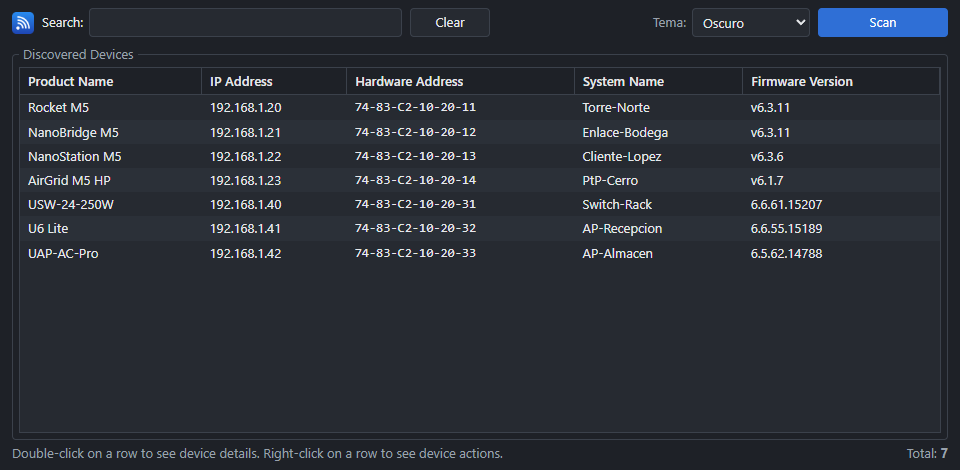
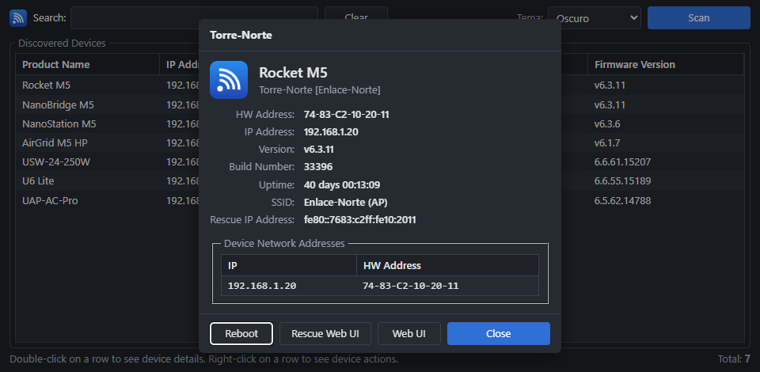
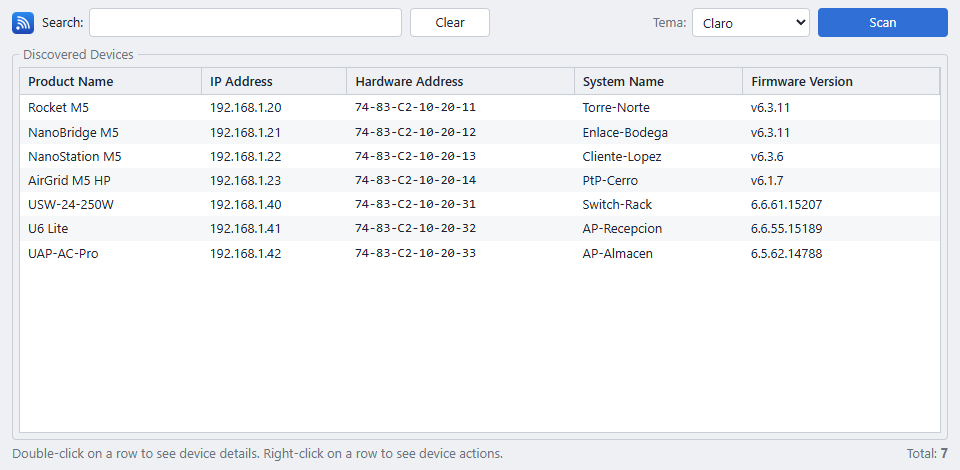
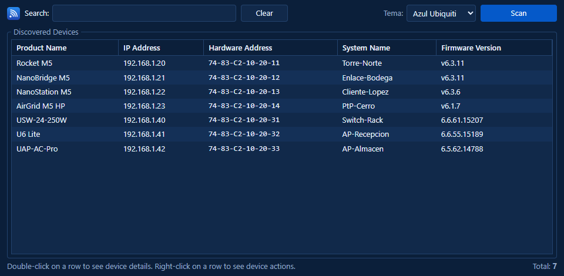
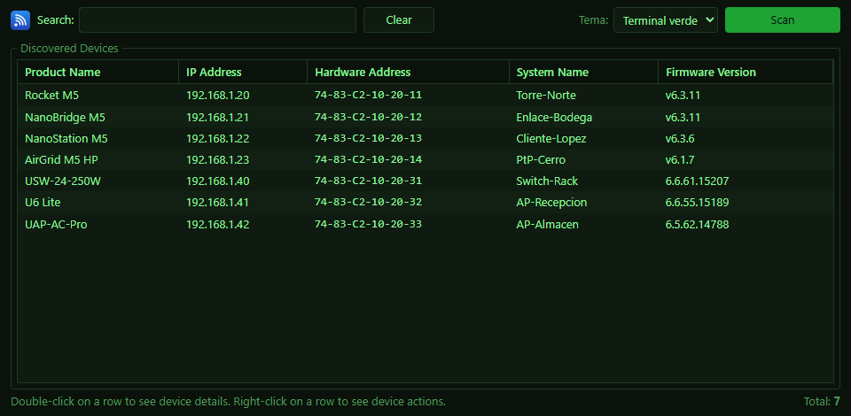
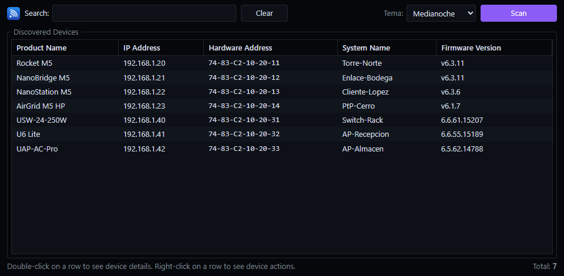
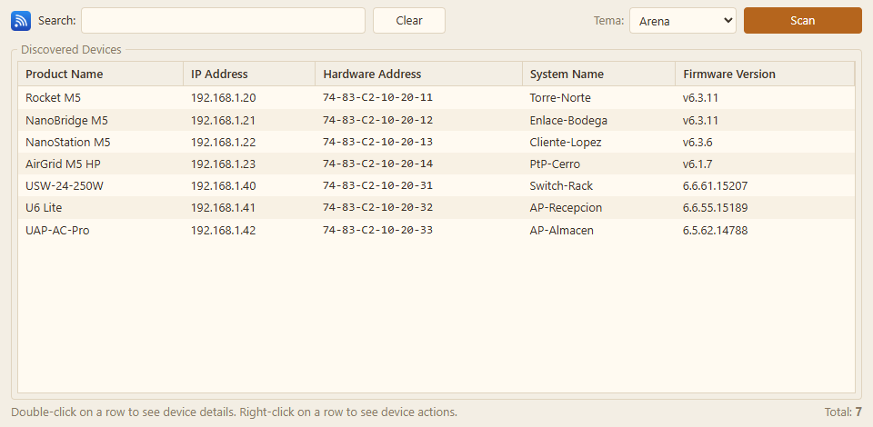
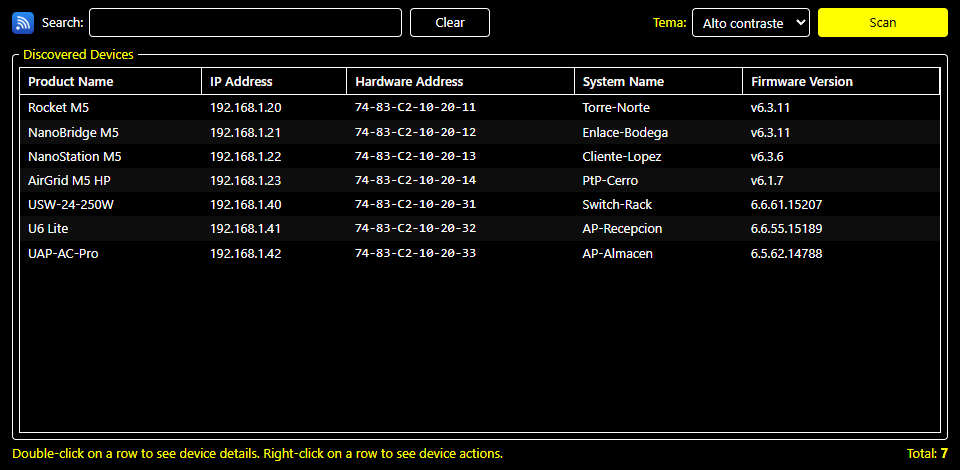

<div align="center">


# Ubiquiti Discovery (sin Java)

**Encuentra tus equipos Ubiquiti en la red, como siempre, pero sin depender de Java.**

[⬇ Descargar la última versión](https://github.com/Gaaraalex/ubnt-discovery-next/releases/latest)

</div>



## Por qué existe este proyecto

Durante años, **Ubiquiti Discovery Utility** fue la herramienta de cabecera para
localizar antenas, radioenlaces y puntos de acceso en una red local. Pero Ubiquiti
dejó de actualizarla: su última versión, la 2.5.1, es de 2017.

Con el tiempo, mantenerla en marcha se volvió un problema. Solo funciona con una
versión antigua de Java 8 que ya no recibe parches de seguridad, así que para seguir
usándola había que dejar instalado en el equipo un componente obsoleto y vulnerable.

Este proyecto nace para darle una segunda vida: conserva todo lo que hacía útil a la
herramienta original, funciona de la misma manera, y se apoya en tecnología actual
que no necesita Java ni nada que instalar aparte.

## Descarga

En la página de [versiones publicadas](https://github.com/Gaaraalex/ubnt-discovery-next/releases/latest)
hay dos opciones:

| Archivo | |
| --- | --- |
| **`UbiquitiDiscovery-…-instalador.exe`** | ⭐ **Recomendado.** Se instala en segundos, sin permisos de administrador, crea accesos directos y abre mucho más rápido. |
| `UbiquitiDiscovery-…-portable.exe` | Para llevarlo en una memoria USB. No se instala, pero tarda más en abrir porque se descomprime cada vez. |

**Primer uso:**

- Los ejecutables no están firmados digitalmente. Si aparece el aviso de SmartScreen,
  pulsa **Más información → Ejecutar de todas formas**.
- Cuando Windows lo pregunte, permite la aplicación en el **Firewall** para redes
  privadas. Si no, las respuestas de los equipos no llegan y la lista queda vacía.

## Funciones

- **Búsqueda de equipos** airOS / UISP y **UniFi** en la red local (UDP 10001), con el
  mismo protocolo que la herramienta original.
- Tabla con **producto, IP, MAC, nombre del sistema y firmware**, con búsqueda
  (admite comodines `*` y `?`) y orden por columnas.
- **Detalles** del equipo: direcciones de red, versión, build, tiempo activo, SSID y
  dirección IPv6 de rescate.
- **Web UI**: abre la interfaz web del equipo en el navegador.
- **Reboot**: reinicia el equipo con el mismo mecanismo seguro de desafío y respuesta
  del original.
- **Rescue Web UI**: abre un túnel SSH por IPv6 cuando la interfaz web no responde por IPv4.
- **Copiar** filas al portapapeles (Ctrl+C).
- **8 temas** a elegir.



## Temas

Elige el que más te guste en el selector **Tema**, arriba a la derecha. La aplicación
lo recuerda para la próxima vez, y la opción **Sistema** sigue el modo claro u oscuro
de Windows.

<table>
  <tr>
    <td><br><sub><b>Claro</b></sub></td>
    <td><br><sub><b>Azul Ubiquiti</b></sub></td>
  </tr>
  <tr>
    <td><br><sub><b>Terminal verde</b></sub></td>
    <td><br><sub><b>Medianoche</b></sub></td>
  </tr>
  <tr>
    <td><br><sub><b>Arena</b></sub></td>
    <td><br><sub><b>Alto contraste</b></sub></td>
  </tr>
</table>

También están **Oscuro** (el de la primera captura) y **Sistema**.

> Las capturas usan una red de ejemplo generada con `scripts/fake-device.js --demo`;
> los nombres, IP y MAC son ficticios.

## Requisitos

- Windows 10 u 11 de 64 bits.
- Estar en la misma red local que los equipos.

## Compilar desde el código

Necesitas [Node.js](https://nodejs.org/) 22 o superior.

```bash
npm install
npm test          # pruebas del protocolo y del cifrado
npm start         # abre la aplicación en modo desarrollo
npm run dist      # genera el instalador y el portable en dist/
```

### Herramientas de prueba

- `node scripts/fake-device.js` simula un NanoStation y un UniFi AP en tu propio PC,
  para probar la búsqueda y el reinicio sin hardware real (usuario `ubnt`,
  contraseña `ubnt`). Con `--demo` simula una red de ejemplo más completa.
- `node scripts/scan-cli.js` hace una búsqueda de 10 segundos desde la consola.
- `node scripts/make-icon.js` vuelve a generar el icono de la aplicación.

## Cómo funciona el protocolo

| Consulta | Bytes | Destino |
| --- | --- | --- |
| v1 | `01 00 00 00` | UDP 10001 a `255.255.255.255` y `233.89.188.1` |
| v2 (UniFi) | `02 08 00 00` | igual |

Los equipos responden con `versión, comando, longitud` seguido de registros TLV
(tipo de 1 byte, longitud de 2 bytes, datos). Los tipos están documentados en
[`src/lib/protocol.js`](src/lib/protocol.js).

## Aviso

Proyecto independiente, **sin relación con Ubiquiti Inc.** "Ubiquiti", "UniFi" y
"airOS" son marcas de sus respectivos propietarios. El protocolo se reconstruyó para
dar continuidad a una herramienta descontinuada, y el proyecto no incluye código ni
imágenes de Ubiquiti. Úsalo solo con equipos que te pertenezcan o que estés
autorizado a administrar.

## Licencia

[MIT](LICENSE)
